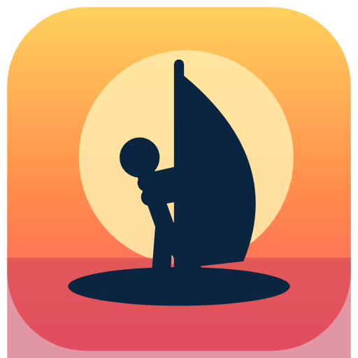
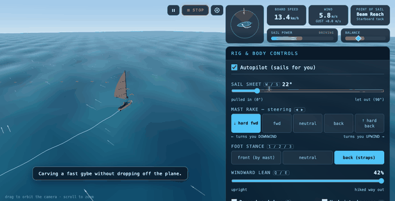
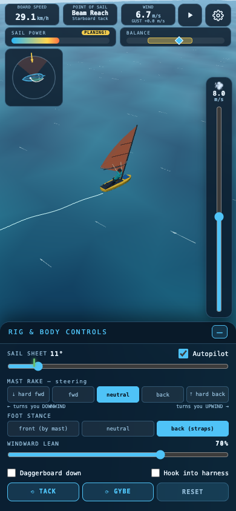

  

<h1 align="center">Windsurf Simulator</h1>

  <b>Learn to windsurf before you get wet.</b> 
  A free 3D browser game that teaches the real physics of windsurfing: sail trim, apparent wind,
  planing and balance.

  

  
  
  
  
  
  
  

  <a href="https://windsurfsimulator.com/">Play</a> ·
  <a href="#see-it-sail">See it sail</a> ·
  <a href="#the-physics">The physics</a> ·
  <a href="#controls">Controls</a> ·
  <a href="#contributing">Contributing</a>

---

You control the same levers a real windsurfer has: sheet angle, mast rake, foot stance, body lean,
daggerboard and harness. The board responds the way a real one would. There is no rudder and no
arcade shortcut: you steer by moving the sail, you plane when the physics say you can, and you get
catapulted when you get greedy with the power.

Nothing to install. Open [windsurfsimulator.com](https://windsurfsimulator.com/) on a desktop,
tablet or phone.

## See it sail

### Carve a gybe on the plane

  

### Start on autopilot, or watch a lesson

New riders can leave **Autopilot** on: it trims the sail and holds your balance, so you can steer
and learn the points of sail without falling. Switch it off to practise for real. Or tap
**▶ DEMO** and the board sails a whole guided lesson by itself (*Beginner* or *Freeride*),
narrating each step. Touch any control to take over.

### On your phone

  

## The physics

| Real mechanic | In the game |
|---|---|
| A sail is an airfoil: its angle of attack controls lift | **Sheet slider** vs. the moving green "optimal trim" tick. Too far out: luffing (flaps, no power). Too far in: stall (heel force, no drive). |
| Apparent wind swings forward as you accelerate | The optimal trim tick moves toward 0° as you speed up, so you must keep sheeting in. Drive dies when the apparent wind reaches the bow (your natural top speed). |
| No rudder: you steer by moving the sail's centre of effort | **Mast rake**: back to luff up (turn upwind), forward to bear away (turn downwind). |
| No-go zone, about 45° either side of the wind | The sail cannot drive there; you stop and drift backwards ("in irons"). |
| The rider counters the sideways pull | **Windward lean** slider and balance meter. Too little lean for the power: **catapult**. Too much lean when the power dies: you fall in backwards. |
| The daggerboard resists leeway at low speed but lifts violently at high speed | Down: little sideways drift. Up: you slip sideways when slow. Down **while planing**: spinout crash. |
| Planing: above a speed and power threshold the hull skims and drag collapses | Reach about 8 kn with good power on a beam or broad reach: PLANING badge, big acceleration. Then move back into the straps or you'll pearl the nose. |
| The harness carries the load but commits you | +38% effective lean, but gusts fling you faster when overpowered. Hooking in needs real pull in the sail. |
| Tacking and gybing | Manoeuvres with realistic entry conditions: a tack needs speed and an upwind-ish course, a gybe starts from a broad reach. The sailor switches sides. |
| Hydrofoil | Turn on **Foil** in settings: a foil replaces the daggerboard, and at speed the board lifts out of the water. |
| Gusts and wind shifts | True wind oscillates ±15% and wanders ±6°. Watch the GUST readout. |

> ⚠️ It's a *learning toy*, not a certified trainer. The physics are a faithful simplification
> meant to build intuition, not to replace time on the water.

## Controls

| Do this | Key |
|---|---|
| ⛵ Sheet in / out | **W** / **S** (hold) |
| 🧭 Bear away (downwind) / luff up (upwind) | **←** / **→** (hold; the mast rake springs back on release) |
| 🏄 Less / more windward lean | **Q** / **E** (hold) |
| 🦶 Stance: front / neutral / back straps | **1** / **2** / **3** |
| ⬇️ Daggerboard up / down | **D** |
| 🪝 Hook in / out of the harness | **H** |
| 🔄 Tack / gybe | **T** / **G** |
| ↩️ Reset | **R** |
| 🎥 Orbit / zoom the camera | drag / scroll (pinch on touch) |

- Every control is also in the on-screen panel, so it plays fully by touch on a phone.
- "Smart interlocks" refuse impossible combinations (hooking into a powerless sail, back straps
  with no speed…) and explain why.

## Languages

**20 languages**: English, Українська, Deutsch, Français, Español, Italiano, Português, Nederlands,
Polski, Čeština, Svenska, Dansk, Suomi, Ελληνικά, Türkçe, Bahasa Indonesia, Русский, 中文, 日本語,
한국어. The game picks your browser language and remembers the one you choose. Each has its own
page, for example [windsurfsimulator.com/uk/](https://windsurfsimulator.com/uk/).

English and Ukrainian are hand-written; the other 18 are AI-translated and not yet reviewed by
native speakers, so corrections are very welcome.

## How it's built

- [three.js](https://threejs.org/) r160 for the WebGL scene, self-hosted so the game loads even
  where public CDNs are blocked.
- Plain ES modules: **no build step, no bundler, no framework**.
- Static files on GitHub Pages, deployed by [GitHub Actions](.github/workflows/deploy.yml) on every
  push to `main`.

| File | What it does |
|---|---|
| [`site/src/sim.js`](site/src/sim.js) | Physics: apparent wind, sail lift curve, points of sail, planing, foiling, balance, crashes |
| [`site/src/world.js`](site/src/world.js) | three.js scene: sea shader, wind streaks, board, rig and sailor, splash and wake |
| [`site/src/ui.js`](site/src/ui.js) | Control panel, interlocks, autopilot, HUD meters, compass |
| [`site/src/demo.js`](site/src/demo.js) | The guided demo lessons |
| [`site/src/i18n.js`](site/src/i18n.js) | Translations for all 20 languages |
| [`site/src/main.js`](site/src/main.js) | Game loop |

## Contributing

Issues and pull requests are welcome, especially:

- **Translation fixes** for any of the 18 AI-translated languages, in
  [`site/src/i18n.js`](site/src/i18n.js).
- **Physics tweaks** that make a mechanic feel truer to life.

To try a change, serve the `site/` folder with any static server (`python3 serve.py` does it with
caching off) and reload the page.

## License

[MIT](LICENSE). Made by **Viacheslav Mukha**, with help from Claude (Anthropic).
